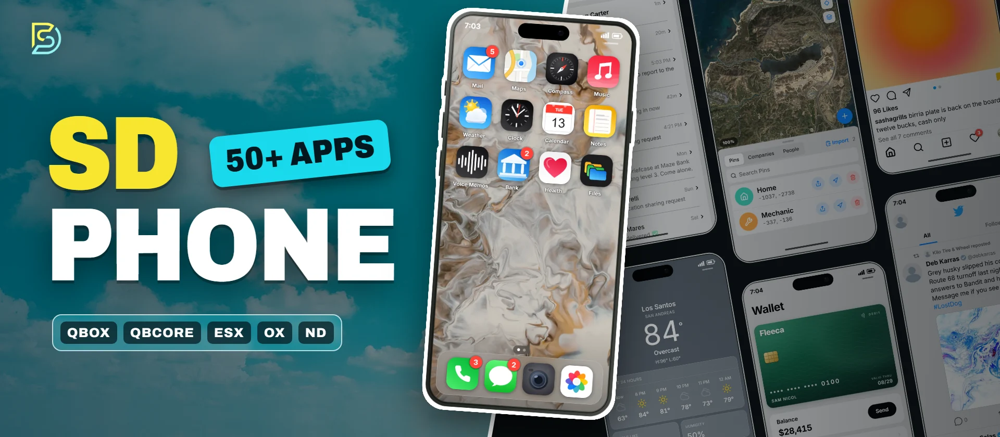
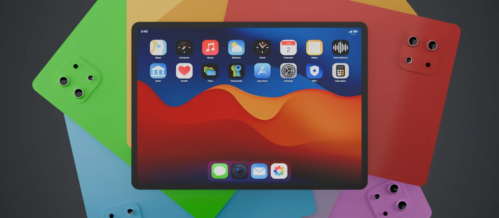
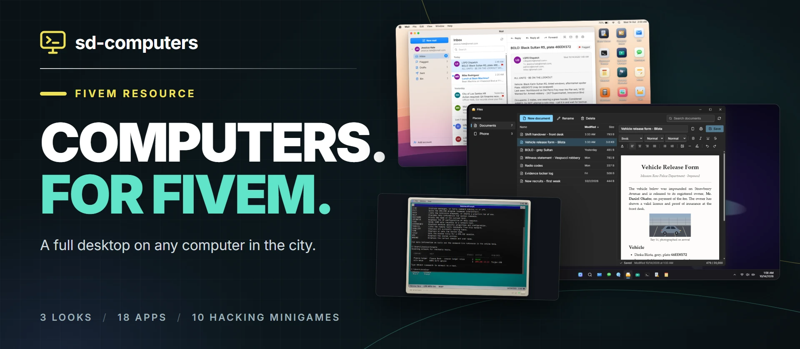

<!-- The two charts and the line between the numbers markers are redrawn every day by scripts/profile/build.mjs.
     The rest is written by hand. -->

I make FiveM resources for Qbox, QBCore, ESX, ox_core and ND, and everything on this page is free. sd-phone is the
big one, and sd-tablet and sd-computers share its accounts and data. The rest are [scripts and tools](https://github.com/orgs/Samuels-Development/repositories) I've built along
the way.

The paid scripts are on the store, and the Discord is the place for questions.

**[sd-phone](https://github.com/Samuels-Development/sd-phone)** is a phone with over 50 apps: calls, messages, mail,
maps, banking, social apps and games. Scripts written for lb-phone, qs-smartphone, gksphone, roadphone or YSeries keep
working, and lb-phone and YSeries players can bring their numbers, chats and photos over.
[Try it in your browser](https://fivem.samueldev.shop/phone).

<table>
<tr>
<td width="50%" valign="top">

<b><a href="https://github.com/Samuels-Development/sd-tablet">sd-tablet</a></b> has sd-phone's apps, accounts and data on a bigger screen.

</td>
<td width="50%" valign="top">

<b><a href="https://github.com/Samuels-Development/sd-computers">sd-computers</a></b> puts a desktop on any computer in the city, with mail, logs, a command prompt to hack from and a business manager.

</td>
</tr>
</table>

## Activity

<!-- numbers:start -->
63,919 downloads and 1,148 stars across 39 resources, and 1,215 commits in the last year.
<!-- numbers:end -->

### Stars

<picture>
  <source media="(prefers-color-scheme: dark)" srcset="https://raw.githubusercontent.com/Samuels-Development/.github/main/profile/assets/stars-dark.svg">
  
</picture>

### Commits in the last year

<picture>
  <source media="(prefers-color-scheme: dark)" srcset="https://raw.githubusercontent.com/Samuels-Development/.github/main/profile/assets/commits-dark.svg">
  
</picture>

## Partners

**[Fivemanage](https://refer.fivemanage.com/samuel)** hosts the photos, videos and voice notes taken on sd-phone. A free Media token is all it needs.
