<!-- The pictures in assets/ and everything between a :start and an :end marker are redrawn every day by
     scripts/profile/build.mjs (.github/workflows/profile.yml). Edit the rest by hand. -->

  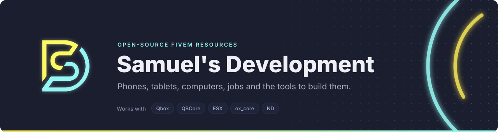

  Samuel's Development builds FiveM resources for Qbox, QBCore, ESX, ox_core and ND. The open-source ones are
  here: a phone, a tablet and a desktop that share one set of accounts and data, the library under them, and
  resources for most of what a server runs. The premium scripts are on the store.

  
  
  
  

<!-- stats:start -->
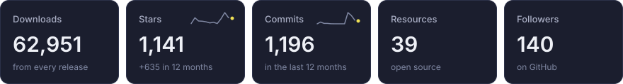
<!-- stats:end -->

## Featured

<!-- featured:start -->

  <a href="https://github.com/Samuels-Development/sd-phone">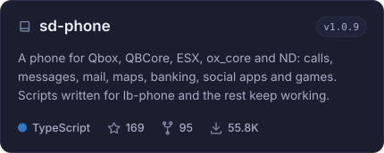</a>
  <a href="https://github.com/Samuels-Development/sd-tablet">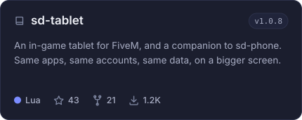</a>

  <a href="https://github.com/Samuels-Development/sd-computers">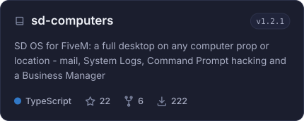</a>
  <a href="https://github.com/Samuels-Development/sd_lib">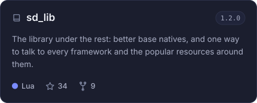</a>

  <a href="https://github.com/Samuels-Development/sd-policeradar">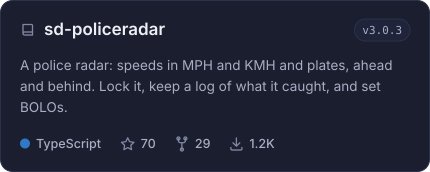</a>
  <a href="https://github.com/Samuels-Development/sd-zonecreator">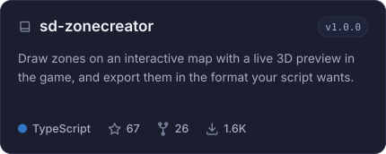</a>

<!-- featured:end -->

## Activity

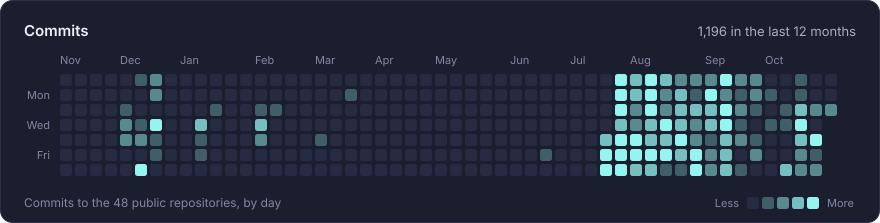
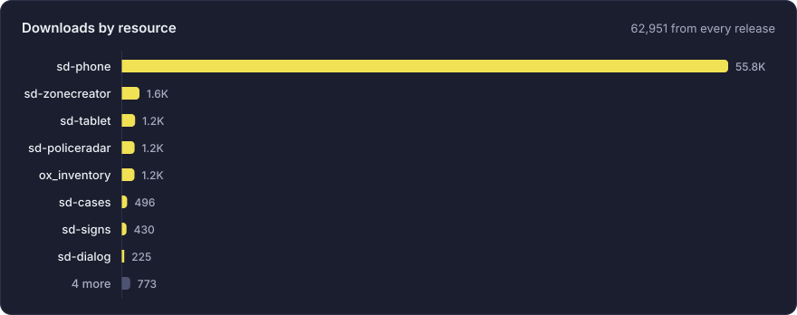
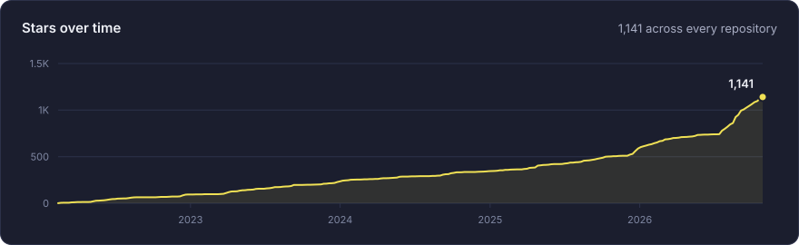

<!-- resources:start -->

<b>All 39 public resources</b>, with their stars, downloads and latest release

 

| Resource | What it is | Stars | Downloads | Release |
|---|---|--:|--:|---|
| [**sd-phone**](https://github.com/Samuels-Development/sd-phone) | A phone for Qbox, QBCore, ESX, ox_core and ND: calls, messages, mail, maps, banking, social apps and games. Scripts written for lb-phone and the rest keep working. | 169 | 55,840 | `v1.0.9` |
| [**sd-zonecreator**](https://github.com/Samuels-Development/sd-zonecreator) | Draw zones on an interactive map with a live 3D preview in the game, and export them in the format your script wants. | 67 | 1,625 | `v1.0.0` |
| [**sd-tablet**](https://github.com/Samuels-Development/sd-tablet) | An in-game tablet for FiveM, and a companion to sd-phone. Same apps, same accounts, same data, on a bigger screen. | 43 | 1,225 | `v1.0.8` |
| [**sd-policeradar**](https://github.com/Samuels-Development/sd-policeradar) | A police radar: speeds in MPH and KMH and plates, ahead and behind. Lock it, keep a log of what it caught, and set BOLOs. | 70 | 1,172 | `v3.0.3` |
| [**ox_inventory**](https://github.com/Samuels-Development/ox_inventory) |  | 52 | 1,165 | `v2.45.0` |
| [**sd-cases**](https://github.com/Samuels-Development/sd-cases) |  | 31 | 496 | `v1.0.3` |
| [**sd-signs**](https://github.com/Samuels-Development/sd-signs) | 3D channel-letter signs for FiveM. Type it, colour it, place it. 129 glyphs, 10 colours, matte or neon, up to 3 rows — colour is a runtime tint, so the whole palette is 258 models and ~5 MB. | 25 | 430 | `v1.1.0` |
| [**sd-dialog**](https://github.com/Samuels-Development/sd-dialog) |  | 19 | 225 | `v1.0.0` |
| [**sd-computers**](https://github.com/Samuels-Development/sd-computers) | SD OS for FiveM: a full desktop on any computer prop or location - mail, System Logs, Command Prompt hacking and a Business Manager | 22 | 222 | `v1.2.1` |
| [**sd-waypoints**](https://github.com/Samuels-Development/sd-waypoints) |  | 12 | 205 | `v1.0.0` |
| [**sd-itemspawner**](https://github.com/Samuels-Development/sd-itemspawner) | Admin item spawner for ox_inventory: every registered item in a searchable grid, per-item quantities, metadata editor, saved loadouts, and delivery to yourself, a player, nearby players or everyone online. | 11 | 192 | `v1.0.0` |
| [**sd-policetape**](https://github.com/Samuels-Development/sd-policetape) |  | 9 | 154 | `v1.0.1` |
| [**sd-levels**](https://github.com/Samuels-Development/sd-levels) | A comprehensive level/skill system with a nice UI. | 46 |  | `2.0.1` |
| [**ox_target**](https://github.com/Samuels-Development/ox_target) |  | 44 |  |  |
| [**sd_lib**](https://github.com/Samuels-Development/sd_lib) | The library under the rest: better base natives, and one way to talk to every framework and the popular resources around them. | 34 |  | `1.2.0` |
| [**sd-parceltheft**](https://github.com/Samuels-Development/sd-parceltheft) |  | 23 |  | `1.0.6` |
| [**sd-3dme**](https://github.com/Samuels-Development/sd-3dme) |  | 23 |  | `1.0.1` |
| [**sd-vehcontrol**](https://github.com/Samuels-Development/sd-vehcontrol) |  | 21 |  | `1.0.2` |
| [**sd-selfstorage**](https://github.com/Samuels-Development/sd-selfstorage) |  | 21 |  | `1.0.2` |
| [**sd-fence**](https://github.com/Samuels-Development/sd-fence) |  | 20 |  |  |
| [**sd-christmas**](https://github.com/Samuels-Development/sd-christmas) |  | 19 |  | `1.0.2` |
| [**sd-objective**](https://github.com/Samuels-Development/sd-objective) |  | 17 |  |  |
| [**qb-garbagejob**](https://github.com/Samuels-Development/qb-garbagejob) |  | 16 |  |  |
| [**sd-notify**](https://github.com/Samuels-Development/sd-notify) |  | 16 |  | `1.0.0` |
| [**sd-creator**](https://github.com/Samuels-Development/sd-creator) |  | 15 |  |  |
| [**sd-reviews**](https://github.com/Samuels-Development/sd-reviews) |  | 15 |  | `1.0.0` |
| [**sd-density**](https://github.com/Samuels-Development/sd-density) |  | 15 |  | `1.0.3` |
| [**qb-menu**](https://github.com/Samuels-Development/qb-menu) |  | 12 |  |  |
| [**sd-minesweeper**](https://github.com/Samuels-Development/sd-minesweeper) |  | 12 |  |  |
| [**sd-pickup-bike**](https://github.com/Samuels-Development/sd-pickup-bike) |  | 11 |  |  |
| [**ms-peds**](https://github.com/Samuels-Development/ms-peds) |  | 9 |  |  |
| [**sd-phone-props**](https://github.com/Samuels-Development/sd-phone-props) |  | 8 |  |  |
| [**sd-simonsays**](https://github.com/Samuels-Development/sd-simonsays) |  | 7 |  |  |
| [**sd-speedlimiter**](https://github.com/Samuels-Development/sd-speedlimiter) |  | 5 |  | `1.0.0` |
| [**sd-phone-app-templates**](https://github.com/Samuels-Development/sd-phone-app-templates) | App templates for the sd-phone custom app system. Build phone apps with plain JS, React, Vue or Svelte; lb-phone app compatible. | 5 |  |  |
| [**sd-tablet-props**](https://github.com/Samuels-Development/sd-tablet-props) | Streamed in-hand tablet props for sd-tablet, one model per frame colour | 4 |  |  |
| [**sd-locales**](https://github.com/Samuels-Development/sd-locales) |  | 1 |  |  |
| [**sd-tracers**](https://github.com/Samuels-Development/sd-tracers) |  | 1 |  |  |
| [**sd-computers-app-templates**](https://github.com/Samuels-Development/sd-computers-app-templates) | App templates for the sd-computers custom app system. Build desktop apps with plain JS, React, Vue or Svelte, plus Wrenchworks, a full example. | 0 |  |  |

<!-- resources:end -->

## Partners

**[Fivemanage](https://refer.fivemanage.com/samuel)** hosts the photos, videos and voice notes taken on sd-phone. A free Media token is all it needs.

<!-- updated:start -->
Numbers from GitHub, 27 October 2026.
<!-- updated:end -->
